# Ferrous Commander

A dual-panel ("orthodox") file manager for macOS, written in Rust with
[GPUI](https://crates.io/crates/gpui). Its behavior follows a clean-room specification of
Commander One 3.18, derived by reverse-engineering the shipped app with REA. See
[SPEC.md](SPEC.md) for the specification and [docs/evidence/](docs/evidence/) for the
observations it rests on. No code, artwork or resources from Commander One are included.

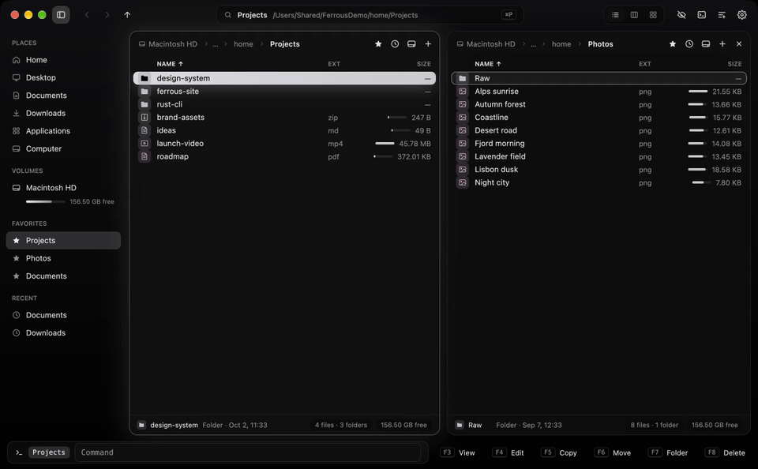

[Full demo video (MP4)](docs/media/ferrous-commander-demo.mp4)

| | |
|---|---|
| 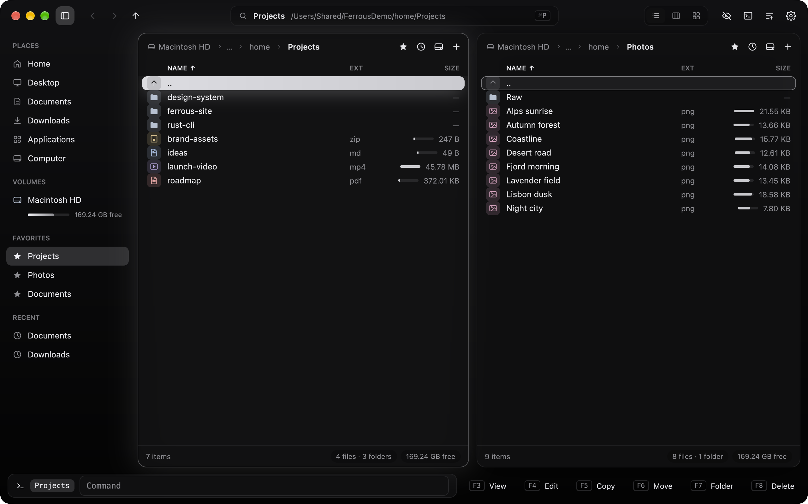 | 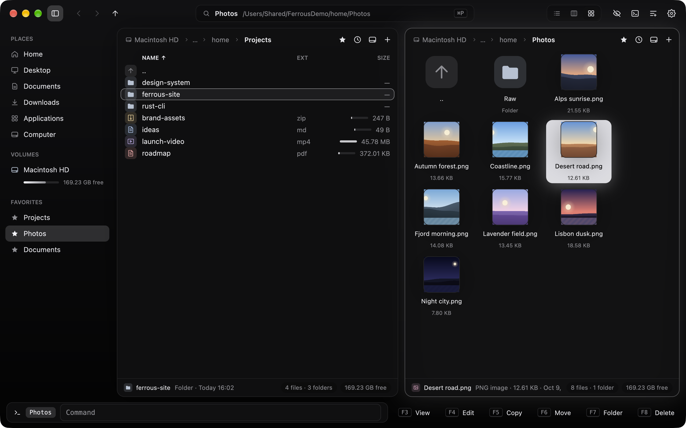 |
| 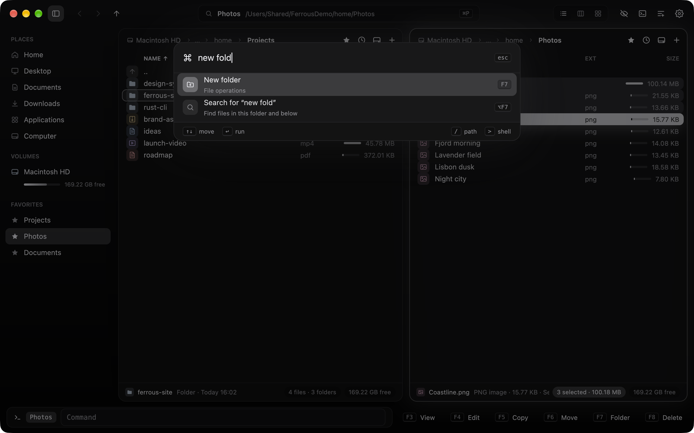 | 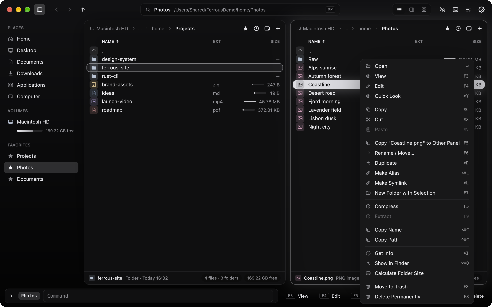 |
| 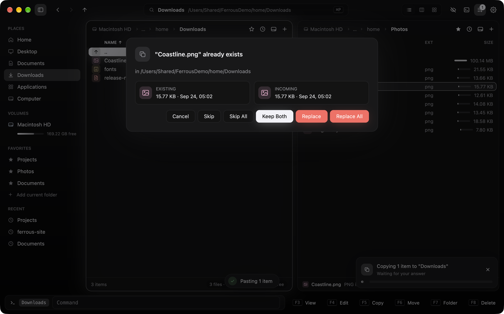 | 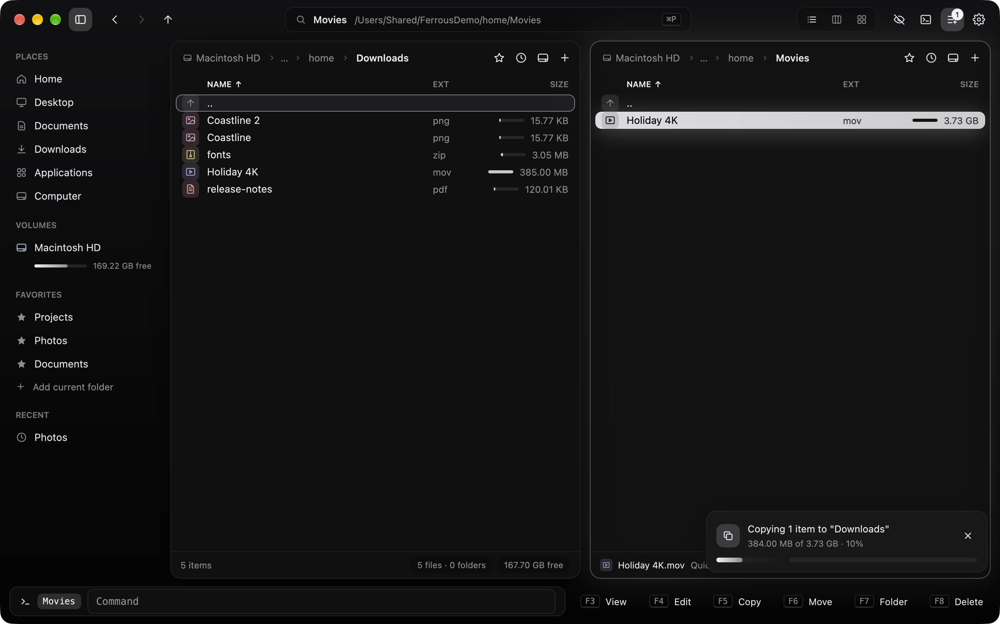 |
| 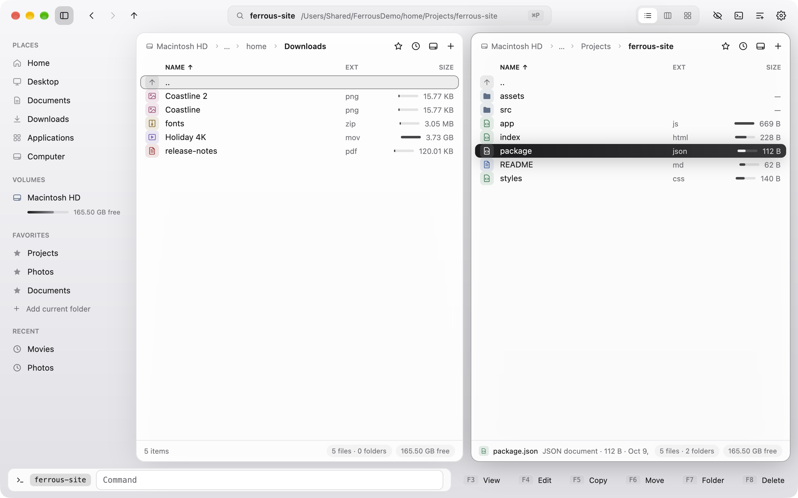 | 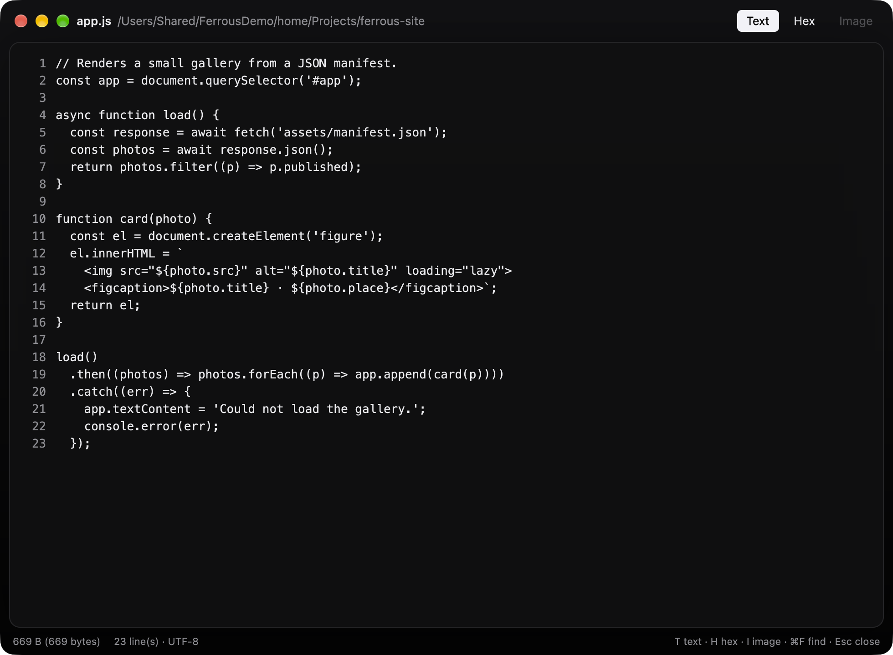 |
| 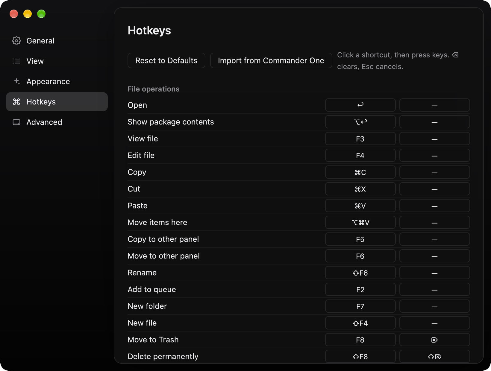 | 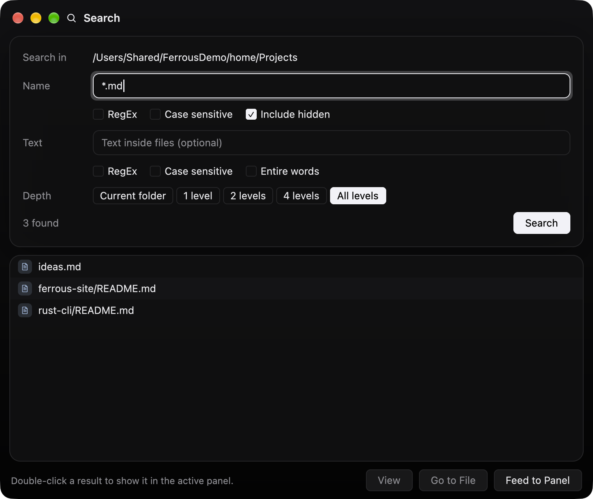 |

The screenshots and video are recorded by `scripts/demo.sh`. It runs the app on generated
sample data with a throw-away home folder, and captures only the app's own windows.

## Build and run

Requirements: macOS 11+, Rust 1.85+ (edition 2024), Xcode with the Metal toolchain.

```sh
cargo run --release -p fc-app          # run from source
scripts/bundle.sh                      # build "dist/Ferrous Commander.app"
scripts/bundle.sh --install            # …and copy it to /Applications
```

Settings, shortcuts and the last session are kept in
`~/Library/Application Support/Ferrous Commander/` (`settings.json`, `keymap.json`,
`session.json`). Set `FC_CONFIG_DIR` to use a different folder.

## Look and feel

The interface ("Aurora") is built entirely with GPUI:

- **Frosted window.** A blurred, gradient backdrop and a custom title bar with the macOS
  traffic lights.
- **Omnibox and command palette.** The title-bar omnibox shows where you are. Click it or
  press **⌘P** to open the command palette, which fuzzy-searches every command, place,
  volume, favorite and recent folder.
  - Type `/` or `~` to jump to a path (with folder suggestions).
  - Type `>` to run a shell command.
  - Anything else also offers "Search for …".
- **Sidebar.** Places, volumes with capacity bars and eject, favorites, and recent
  folders. Toggle it from the title bar or with ⌥⌘S.
- **Panel cards.** Each panel is a floating card. The active one glows, and the glow
  pulses when you switch panels.
- **Gliding cursor.** In Full mode the cursor highlight is a spring-animated pill that
  glides between rows. Rows fade in when you open a folder.
- **File tiles.** Colour-coded tiles show the file type (folders, apps, images, media,
  archives, code, documents, PDFs, links, executables). Marked items get a check badge,
  and an inline bar shows each item's size relative to the largest in the folder.
- **Readable details.** Clickable breadcrumb chips with a favorite star, friendly dates
  ("Today 14:03"), and a footer showing the item under the cursor plus selection and
  free-space chips.
- **Dock.** The command line sits next to keycap-style F-key buttons.
- **Floating feedback.** Job cards show shimmering progress bars, toasts slide in, and
  dialogs and menus pop in with icons.
- **Colour presets.** Monochrome by default: Black in dark mode and Silver in light mode,
  following the system appearance. White, Classic Blue and Phosphor are also available.
  File-type tiles keep soft, muted tints.

## What it does

- **Two panels with tabs.** Each tab has its own folder, view mode, sort order, history
  and lock state: unlocked, locked (navigating opens a new tab), or locked with folder
  changes allowed. Drag the splitter to resize; ⌥E equalizes and ⌥⇧E swaps the panels.
- **Three view modes.** Full (columns you can choose by right-clicking the header), Brief
  (multi-column names) and Thumbs (image previews).
- **Sorting.** By name (natural order), extension, size (including computed folder sizes),
  modified, created, added, opened, kind and permissions. Folders can sit on top; `..`
  always comes first.
- **Selection.** Cursor plus a separate set of marked items: Space marks the item and
  computes a folder's size, `+`/`-` select or unselect by mask (`*.jpg;*.png`), `*`
  inverts, ⌘A selects all, ⇧-arrows extend, and ⌘-click / ⇧-click work with the mouse.
  Typing a name jumps to it.
- **Finder-style clipboard.** ⌘C copies the selected files, ⌘X cuts them (they show dimmed),
  and ⌘V pastes into the current folder. It uses the macOS pasteboard, so you can copy
  in Finder and paste here, or the other way round. ⌥⌘V pastes as a move. Pasting a
  copy into its own folder makes a duplicate. ⌘⌫ moves to the Trash and ⌥⌘⌫ deletes
  immediately. Right-click a file, or empty space, for the same commands.
- **File operations, run in the background with progress.**
  - Copy (F5) and move/rename (F6, ⇧F6). The destination rules match the spec: an existing
    folder receives the items, a new name renames a single item, and several items go
    into a new folder.
  - Name conflicts offer Replace, Replace All, Skip, Skip All, Keep Both, Merge for
    folders, or Cancel. Errors offer Retry, Skip, Skip All or Abort.
  - F2 adds an operation to the queue, where queued operations run one at a time.
  - Delete to the Trash (F8, ⌦, ⌘⌫) or permanently (⇧F8). New folder (F7, nested paths
    allowed, or "with selection"), new file (⇧F4), duplicate (⌘D), symlink (⌘L) and
    alias (⌥⌘L).
  - Archives: compress to ZIP with a level (⌃F5 / ⌃⌥F5), and extract ZIP, TAR and TAR.GZ
    (⌃F9). Paths that would escape the destination are rejected.
- **Viewer (F3).** Text with line numbers and find (⌘F / ⌘G), hex dump, images, and folder
  totals. F4 opens the file in your editor (the default text editor, or an app you choose
  in Settings).
- **Search (⌥F7).** By name (wildcards or regex, case sensitivity, depth limit) and by
  contents (regex, case, whole words), with live results. Go to File, View, or Feed to
  Panel shows the results as a virtual folder. ⌃⌥F7 searches with Spotlight.
- **Get Info (⌘I).** Kind, sizes, dates, owner, and an editable permission grid and Locked
  flag. Finder's own Get Info window is ⌥⌘I.
- **Drives and places.** A drive popup per panel (⌥F1 / ⌥F2) with free space, eject (⌘E),
  favorites (⌃⌘F), folder history, a clickable path bar, Go to Folder (⇧⌘G) and Connect
  to Server (⌘K, mounted by macOS).
- **Command line.** `cd` changes the panel's folder; any other command runs in a new
  Terminal window in that folder. ⌃↩ pastes the item's name, ⌃⇧↩ pastes its path, ↑/↓
  browse history, and ⌃O opens Terminal.
- **Settings (⌘,).** General, View, Appearance (six original colour presets plus
  "System"), Hotkeys (rebind any command, primary and secondary key) and Advanced
  (confirmations, what to save on quit).
- **Live refresh.** Panels update when files change (FSEvents), and drag-and-drop works
  between panels (hold ⌘ to move) and from Finder.
- **Keyboard compatibility.** The default key map is the one observed in Commander One:
  all 87 bindings. *Help ▸ Import Commander One Shortcuts* reads an existing Commander One
  key map from its preferences.

### Additions beyond Commander One's defaults

⌘C / ⌘X / ⌘V / ⌥⌘V (clipboard), ⌘⌫ / ⌥⌘⌫ (Trash / delete immediately) and ⌘P (command
palette). These are part of the default key map and can be rebound in Settings ▸
Hotkeys. Fixed keys: Backspace goes to the enclosing folder, ⌘⇧. toggles hidden files,
⌘W closes the tab, and Esc clears the type-ahead or the selection.

## Recording the media

```sh
scripts/demo.sh        # needs ffmpeg; keep the display awake while it runs
```

This writes the PNG screenshots, `ferrous-commander-demo.mp4` and a GIF preview into
`docs/media/`.

## Project layout

```
crates/fc-core   UI-independent logic: listing, sorting, selection, tabs and history, key map,
                 file operations, job queue, search, archives, volumes, settings, themes
crates/fc-app    GPUI front end: window, panels, dialogs, menus, viewer, search, settings
docs/evidence    Data derived during reverse engineering (decoded key map, nib wiring, …)
SPEC.md          Behavioral specification and acceptance tests
```

## Tests

```sh
cargo test --workspace                 # 80 tests (76 core, 4 front end)
FC_SMOKE=1 cargo run -p fc-app         # end-to-end run of the real window, then quits
```

`crates/fc-core/tests/observed_keymap.rs` checks the default key map against the data
recorded from Commander One at runtime.

The smoke run drives the actual GPUI window inside a throw-away sandbox folder. It covers
view modes, tabs, selection, dialogs, menus, copy with a conflict prompt, rename,
create, delete, compress, the command palette, the viewer, search and settings windows,
and real keystrokes sent through GPUI's dispatcher (including ⌘P → type → ↩). It prints
`SMOKE OK` or `SMOKE FAIL: …` on stderr.

## Not included

These Commander One features are out of scope, as listed in SPEC.md §10:

- FTP/SFTP/WebDAV/S3 and other cloud connections. ⌘F opens Connect to Server instead.
- MTP and iOS devices, browsing archives as folders, and RAR/7z.
- Folder encryption, the process viewer and the embedded terminal emulator. ⌃O and the
  command line use Terminal.app instead.

### Known limitations

- Text fields handle typing, selection and clipboard, but not input-method composition
  (IME).
- GPUI does not report the numeric-pad flag, so Num+, Num− and Num* respond to the main
  keyboard's `+`, `-` and `*`. While type-ahead is active those keys type instead.
- Get Finder Info and Make Alias go through Finder via AppleScript. The first use asks for
  Automation permission.
