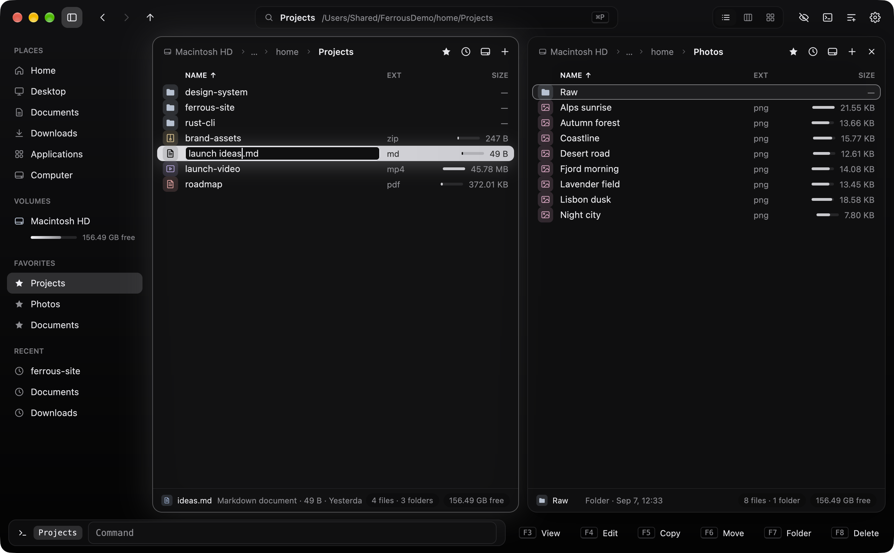
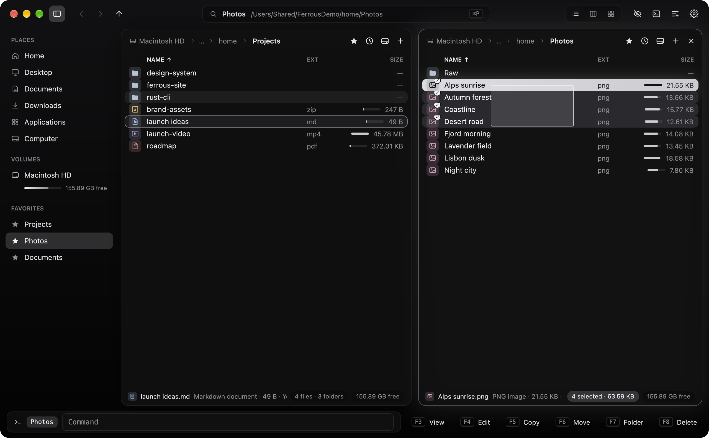
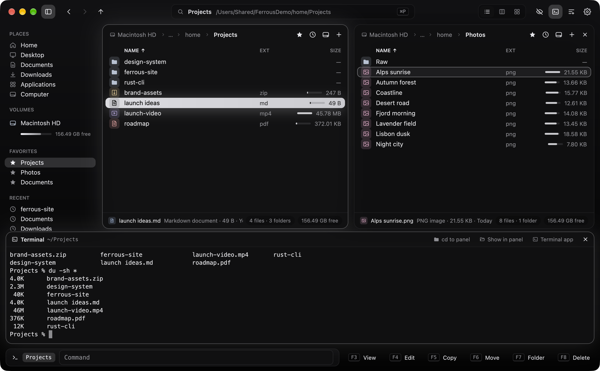
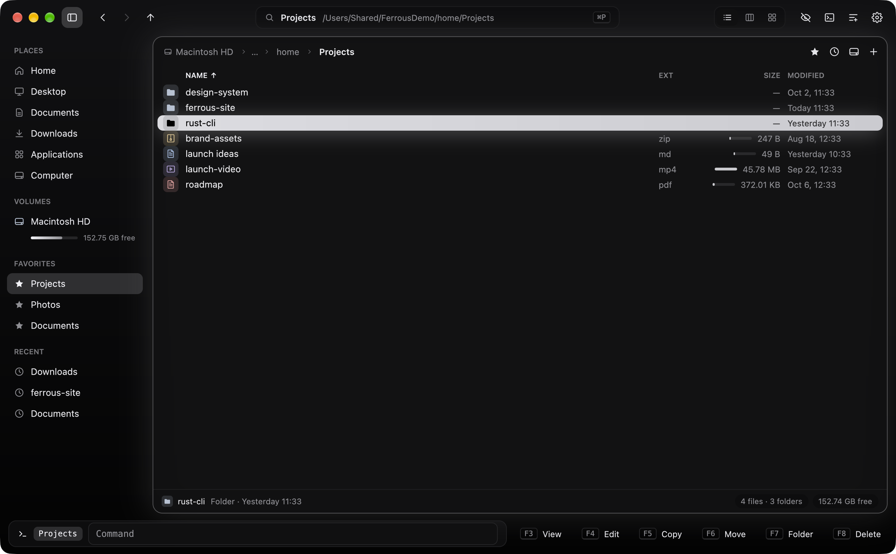
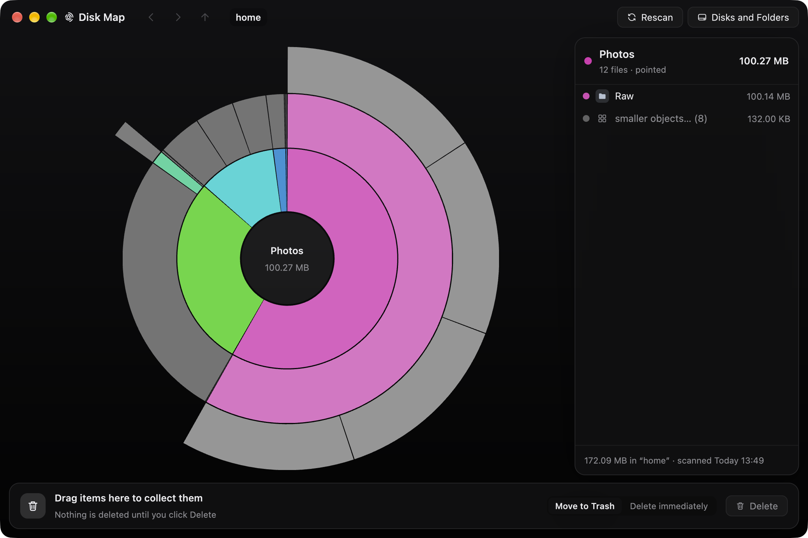
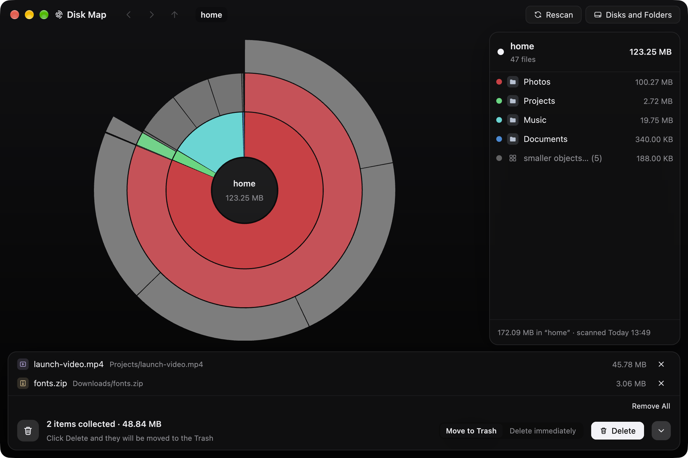
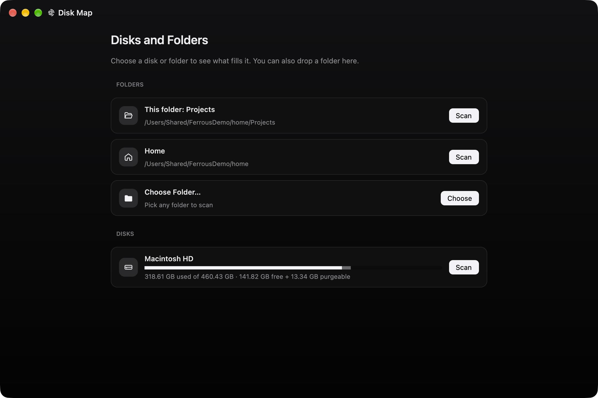

# Ferrous Commander

A dual-panel ("orthodox") file manager for macOS, written in Rust with
[GPUI](https://crates.io/crates/gpui). Its behavior follows a clean-room specification of
Commander One 3.18, derived by reverse-engineering the shipped app with REA. See
[SPEC.md](SPEC.md) for the specification and [docs/evidence/](docs/evidence/) for the
observations it rests on. No code, artwork or resources from Commander One are included.

It also comes with **Disk Map**, a disk-usage analyzer in its own window, built the same way
from a clean-room specification of DaisyDisk 4.34.2 ([SPEC-DiskMap.md](SPEC-DiskMap.md)).


[Full demo video (MP4)](docs/media/ferrous-commander-demo.mp4)

| | |
|---|---|
|  |  |
|  |  |
|  |  |
|  |  |
|  |  |
|  |  |
|  |  |
|  |  |

The screenshots and video are recorded by `scripts/demo.sh`. It runs the app on generated
sample data with a throw-away home folder, and captures only the app's own windows.

## Build and run

Requirements: macOS 11+, Rust 1.85+ (edition 2024), Xcode with the Metal toolchain.

```sh
cargo run --release -p fc-app          # run from source
scripts/bundle.sh                      # build "dist/Ferrous Commander.app"
scripts/bundle.sh --install            # …and copy it to /Applications
```

Settings, shortcuts and the last session are kept in
`~/Library/Application Support/Ferrous Commander/` (`settings.json`, `keymap.json`,
`session.json`). Set `FC_CONFIG_DIR` to use a different folder.

## Look and feel

The interface ("Aurora") is built entirely with GPUI:

- **Frosted window.** A blurred, gradient backdrop and a custom title bar with the macOS
  traffic lights.
- **Omnibox and command palette.** The title-bar omnibox shows where you are. Click it or
  press **⌘P** to open the command palette, which fuzzy-searches every command, place,
  volume, favorite and recent folder.
  - Type `/` or `~` to jump to a path (with folder suggestions).
  - Type `>` to run a shell command.
  - Anything else also offers "Search for …".
- **Sidebar.** Places, volumes with capacity bars and eject, favorites, and recent
  folders. Toggle it from the title bar or with ⌥⌘S.
- **Panel cards.** Each panel is a floating card. The active one glows, and the glow
  pulses when you switch panels.
- **Gliding cursor.** In Full mode the cursor highlight is a spring-animated pill that
  glides between rows. Rows fade in when you open a folder.
- **File tiles.** Colour-coded tiles show the file type (folders, images, media, archives,
  code, documents, PDFs, links, executables). Applications show their real icon. Marked items get a check badge,
  and an inline bar shows each item's size relative to the largest in the folder.
- **Readable details.** Clickable breadcrumb chips with a favorite star, friendly dates
  ("Today 14:03"), and a footer showing the item under the cursor plus selection and
  free-space chips.
- **Dock.** The command line sits next to keycap-style F-key buttons.
- **Floating feedback.** Job cards show shimmering progress bars, toasts slide in, and
  dialogs and menus pop in with icons.
- **Colour presets.** Monochrome by default: Black in dark mode and Silver in light mode,
  following the system appearance. White, Classic Blue and Phosphor are also available.
  File-type tiles keep soft, muted tints.

## What it does

- **One panel or two, with tabs.** One panel fills the window by default. Turn on the right
  panel in *Settings ▸ View ▸ Right panel* (or *View ▸ Show right panel*); its × button
  closes it again. Each tab has its own folder, view mode, sort order, history and lock
  state: unlocked, locked (navigating opens a new tab), or locked with folder changes
  allowed. Drag the splitter to resize; ⌥E equalizes and ⌥⇧E swaps the panels.
- **Three view modes.** Full (columns you can choose by right-clicking the header), Brief
  (multi-column names) and Thumbs (image previews).
- **Sorting.** By name (natural order), extension, size (including computed folder sizes),
  modified, created, added, opened, kind and permissions. Folders can sit on top. Folders
  have no `..` row (Backspace, ⌘↑ and the title-bar arrow go up); *Settings ▸ View* brings
  it back, always first.
- **Selection.** Cursor plus a separate set of marked items: Space marks the item and
  computes a folder's size, `+`/`-` select or unselect by mask (`*.jpg;*.png`), `*`
  inverts, ⌘A selects all, ⇧-arrows extend. Typing a name jumps to it.
- **Mouse.** A click selects one item, ⌘-click toggles and ⇧-click extends. Drag from the
  blank part of a row, or from empty space, to select everything the band touches (hold ⌘
  or ⇧ to add to the selection). Clicking empty space clears the selection.
- **Rename in place.** F2 (or ⇧F6, or *Rename* in the context menu) turns the name into a
  text field with the name before the extension selected. ↩ renames, Esc cancels, and
  clicking elsewhere keeps the new name. Typing a path moves the item there.
- **Finder-style clipboard.** ⌘C copies the selected files, ⌘X cuts them (they show dimmed),
  and ⌘V pastes into the current folder. It uses the macOS pasteboard, so you can copy
  in Finder and paste here, or the other way round. ⌥⌘V pastes as a move. Pasting a
  copy into its own folder makes a duplicate. ⌘⌫ moves to the Trash and ⌥⌘⌫ deletes
  immediately. Right-click a file, or empty space, for the same commands.
- **File operations, run in the background with progress.**
  - Copy (F5) and move/rename (F6, ⇧F6). The destination rules match the spec: an existing
    folder receives the items, a new name renames a single item, and several items go
    into a new folder.
  - Name conflicts offer Replace, Replace All, Skip, Skip All, Keep Both, Merge for
    folders, or Cancel. Errors offer Retry, Skip, Skip All or Abort.
  - *Add to Queue* in the Copy and Move dialogs queues an operation; queued operations run
    one at a time.
  - Delete to the Trash (F8, ⌦, ⌘⌫) or permanently (⇧F8). New folder (F7, nested paths
    allowed, or "with selection"), new file (⇧F4), duplicate (⌘D), symlink (⌘L) and
    alias (⌥⌘L).
  - Archives: compress to ZIP with a level (⌃F5 / ⌃⌥F5), and extract ZIP, TAR and TAR.GZ
    (⌃F9). Paths that would escape the destination are rejected.
- **Viewer (F3).** Text with line numbers and find (⌘F / ⌘G), hex dump, images, and folder
  totals. F4 opens the file in your editor (the default text editor, or an app you choose
  in Settings).
- **Search (⌥F7).** By name (wildcards or regex, case sensitivity, depth limit) and by
  contents (regex, case, whole words), with live results. Go to File, View, or Feed to
  Panel shows the results as a virtual folder. ⌃⌥F7 searches with Spotlight.
- **Get Info (⌘I).** Kind, sizes, dates, owner, and an editable permission grid and Locked
  flag. Finder's own Get Info window is ⌥⌘I.
- **Drives and places.** A drive popup per panel (⌥F1 / ⌥F2) with free space, eject (⌘E),
  favorites (⌃⌘F), folder history, a clickable path bar, Go to Folder (⇧⌘G) and Connect
  to Server (⌘K, mounted by macOS).
- **Terminal.** ⌃O, ⌃` or the terminal button in the title bar opens a terminal below the
  panels, running your login shell in the current folder; the same keys hide it again.
  Drag its top edge to resize. *cd to panel* moves the shell to the panel's folder, *Show
  in panel* does the opposite, and *Terminal app* opens Terminal.app there. Colours,
  full-screen programs (`less`, `vim`, `top`), scrollback (wheel, ⇧PageUp/PageDown),
  selecting with the mouse, ⌘C and ⌘V all work. `exit` closes it. The emulation is
  [`alacritty_terminal`](https://crates.io/crates/alacritty_terminal).
- **Command line.** `cd` changes the panel's folder; any other command runs in the
  terminal, in the panel's folder. ⌃↩ pastes the item's name, ⌃⇧↩ pastes its path, and ↑/↓
  browse history.
- **Settings (⌘,).** General, View, Appearance (six original colour presets plus
  "System"), Hotkeys (rebind any command, primary and secondary key) and Advanced
  (confirmations, what to save on quit).
- **Live refresh.** Panels update when files change (FSEvents).
- **Drag and drop.** Drag items by their icon or name. Dropped on a folder they move there
  (copied when the folder is on another volume; hold ⌥ to copy, ⌘ to move). Dropped on the
  other panel they are copied (hold ⌘ to move). Files dragged in from Finder are copied.
  Drag files out of the window to hand them to another app, as from Finder: drop them on a
  browser to upload them, into Mail to attach them, or on the Desktop. Other apps always get
  a copy; the originals stay where they are.
- **Disk Map (⇧⌘M).** See where the space went and clean it up, in a separate window (see
  [below](#disk-map)).
- **Keyboard compatibility.** The default key map is the one observed in Commander One:
  all 87 bindings. *Help ▸ Import Commander One Shortcuts* reads an existing Commander One
  key map from its preferences.

### Additions beyond Commander One's defaults

⌘C / ⌘X / ⌘V / ⌥⌘V (clipboard), ⌘⌫ / ⌥⌘⌫ (Trash / delete immediately), ⌘P (command
palette) and ⇧⌘M (Disk Map). F2 renames in place; in Commander One it adds to the queue. These are part of
the default key map and can be rebound in Settings ▸ Hotkeys. Fixed keys: Backspace goes
to the enclosing folder, ⌘⇧. toggles hidden files, ⌘W closes the tab, ⌃` shows or hides
the terminal, and Esc clears the type-ahead or the selection.

## Disk Map

A disk-usage analyzer modelled on DaisyDisk. It opens in its own window, so the panels,
dialogs and shortcuts of the main window work exactly as before. Open it with **⇧⌘M**,
*Commands ▸ Disk Map…*, the command palette, or the sunburst button in the title bar.



- **Disks and Folders.** Scan the active panel's folder (or the one folder you marked), your
  home folder, any folder you choose, or a whole disk. Each disk shows a capacity gauge with
  used, free and purgeable space. You can also drop a folder from Finder or from a panel.
- **Fast scan.** Every file is counted by its size on disk, using one thread per core. Hard
  links count once, symlinks are not followed, and other volumes mounted inside the folder
  are skipped. Folders the app may not read are marked with a lock, and the window offers a
  shortcut to *Full Disk Access*.
- **Sunburst.** The centre is the current folder, and each ring is one level deeper. Folders
  are coloured, and a folder's contents share its colour family. Files are grey. Items too
  small to see are merged into translucent "smaller objects" segments. Point at a folder to
  list its contents in the sidebar. Click it to go inside, and click the centre to go back
  up. ⌘-click shows the item in Finder, and right-clicking opens a menu with *Show in Panel*,
  Quick Look, Terminal and rescanning.
- **Sidebar.** The pointed folder's items, largest first, with sizes and colour swatches that
  match the map. Small items are grouped into "smaller objects…", which expands on click.
  At a disk's root, extra rows show *purgeable* and *hidden* space with an explanation.
- **Collector.** Drag items onto the strip at the bottom, or press ⌘⌫, to collect them.
  Collected items leave the map, so you can see what deleting them would change. *Delete*
  starts a 5-second countdown that you can stop, then moves the items to the Trash or, if
  you switch the mode to *Delete immediately*, removes them for good. System folders and
  your home folder cannot be collected.
- **Keys.** ↑/↓ to move through the list, ↩ to open, ⌘↑ or ⌫ to go up, ⌘[ / ⌘] for
  back/forward, Space for Quick Look, ⌘R to rescan the current folder, ⇧⌘R to rescan
  everything, ⇧⌘↑ for Disks and Folders, and ⌘O to scan a folder.

Unlike DaisyDisk, it has no administrator scan, cloud drives, snapshot listing or saved
scans. Deleting goes to the Trash unless you choose otherwise.

## Recording the media

```sh
scripts/demo.sh        # needs ffmpeg; keep the display awake while it runs
```

This writes the PNG screenshots, `ferrous-commander-demo.mp4` and a GIF preview into
`docs/media/`.

## Project layout

```
crates/fc-core   UI-independent logic: listing, sorting, selection, tabs and history, key map,
                 file operations, job queue, search, archives, volumes, settings, themes,
                 disk-usage scanning and sunburst layout (diskmap.rs)
crates/fc-app    GPUI front end: window, panels, dialogs, menus, viewer, search, settings,
                 Disk Map window (diskmap.rs)
docs/evidence    Data derived during reverse engineering (decoded key map, nib wiring, …;
                 daisydisk/ for Disk Map)
SPEC.md          Behavioral specification and acceptance tests
SPEC-DiskMap.md  Disk Map specification and acceptance tests
```

## Tests

```sh
cargo test --workspace                 # 111 tests (96 core, 15 front end)
FC_SMOKE=1 cargo run -p fc-app         # end-to-end run of the real window, then quits
```

`crates/fc-core/tests/observed_keymap.rs` checks the default key map against the data
recorded from Commander One at runtime.

The smoke run drives the actual GPUI window inside a throw-away sandbox folder, with its
own settings folder unless `FC_CONFIG_DIR` is set. It covers view modes, tabs, selection,
dialogs, menus, copy with a conflict prompt, rename in place, create, delete, compress,
the command palette, the viewer, search and settings windows, band selection, dropping
onto folders, closing the right panel, the terminal, the Disk Map (scan, drill down, collect
and delete, and a single real click on a Scan button), application icons, the cursor
highlight staying on its row through fast scrolling, and real keystrokes sent through
GPUI's dispatcher (including ⌘P → type → ↩ and F2 → type → ↩). It prints `SMOKE OK` or
`SMOKE FAIL: …` on stderr. With `FC_SMOKE_SHOTS=<folder>` it also saves screenshots of
the new UI states there.

## Not included

These Commander One features are out of scope, as listed in SPEC.md §10:

- FTP/SFTP/WebDAV/S3 and other cloud connections. ⌘F opens Connect to Server instead.
- MTP and iOS devices, browsing archives as folders, and RAR/7z.
- Folder encryption and the process viewer.

### Known limitations

- Text fields handle typing, selection and clipboard, but not input-method composition
  (IME).
- GPUI does not report the numeric-pad flag, so Num+, Num− and Num* respond to the main
  keyboard's `+`, `-` and `*`. While type-ahead is active those keys type instead.
- Get Finder Info and Make Alias go through Finder via AppleScript. The first use asks for
  Automation permission.

## Support

If this app is useful to you, you can buy me a beer. Thank you! 🍺

[](https://buymeacoffee.com/sonatina_dream)

## License

MIT. See [LICENSE](LICENSE). Third-party crates keep their own licenses.
